<p align="center">
  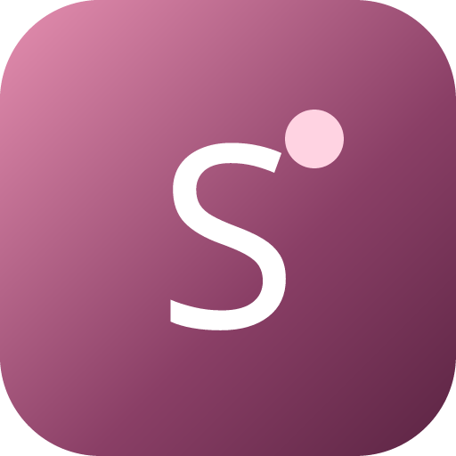
</p>

<h1 align="center">SkinTwin</h1>

<p align="center"><b>Find people with your skin. See what actually worked.</b></p>

<p align="center">
  <a href="https://skintwin-app.vercel.app"><b>Live app</b></a> ·
  <a href="https://www.youtube.com/watch?v=VIDEO_ID"><b>▶ Demo video</b></a> ·
  Built for the YouCam API Skin AI &amp; eCommerce VTO Hackathon
</p>

<!-- Demo video: replace VIDEO_ID above with the YouTube video id. -->

Star ratings tell you little when the reviewer's skin is nothing like yours. SkinTwin scans your face with YouCam AI,
matches you to "skin twins" whose 8 measured scores sit close to yours, and shows what their before/after scans proved
worked, and what made things worse. Then it builds your routine and tracks your own progress week by week.

SkinTwin is **not a store**. It tells you what to use and why, then links out to where to buy it.

## Screenshots

| | |
|---|---|
| 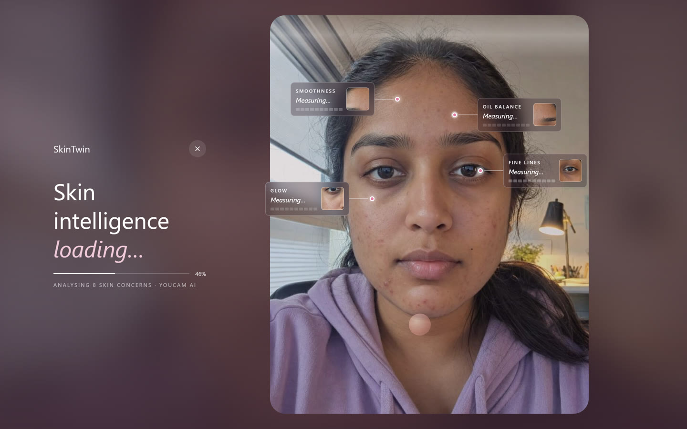 | 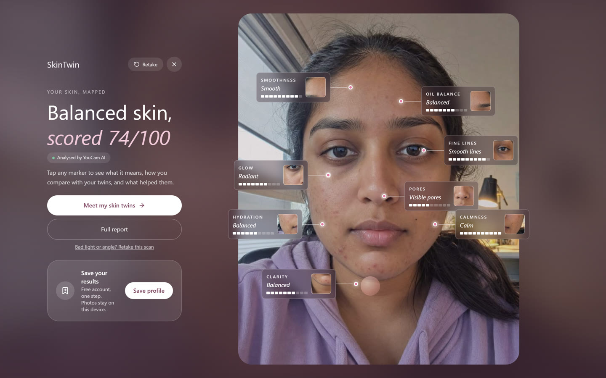 |
| **Live analysis**: YouCam AI Skin Analysis measures 8 concerns | **Results on your face**: 8 scores, 74/100 overall |
| 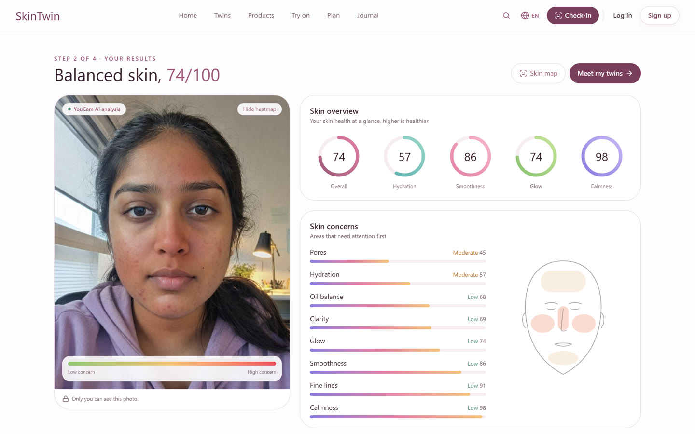 | 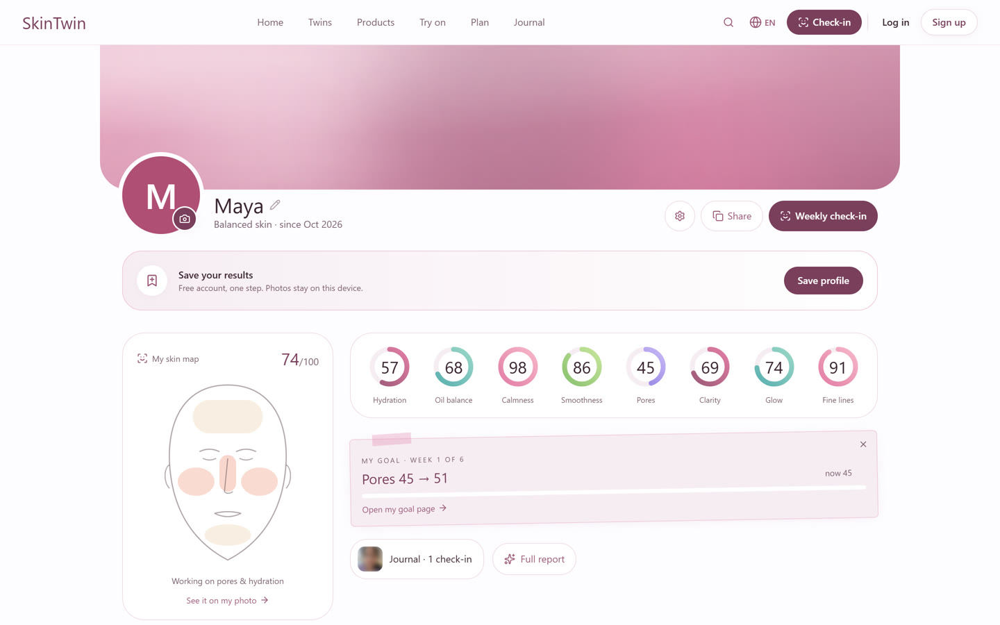 |
| **Heat map** of where concerns sit | **My skin**: score rings, face map and goal |
| 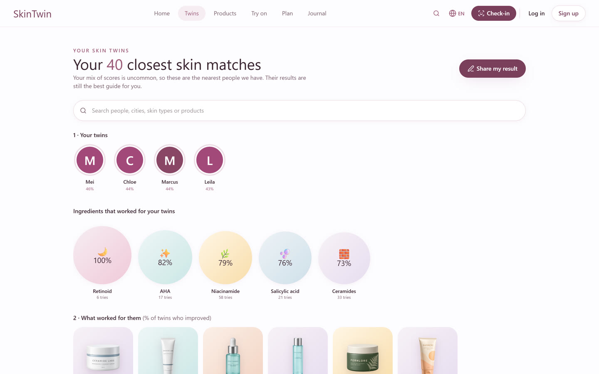 | 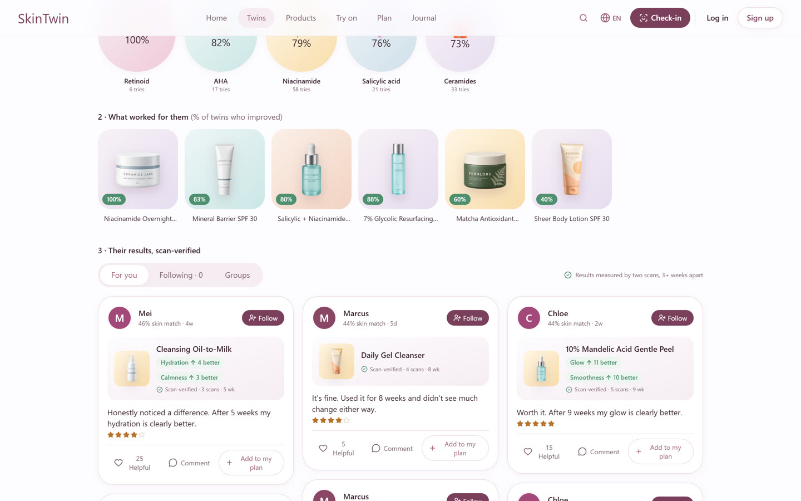 |
| **Your skin twins**: the closest matches and what worked for them | **Scan-verified posts** from twins you can follow |
| 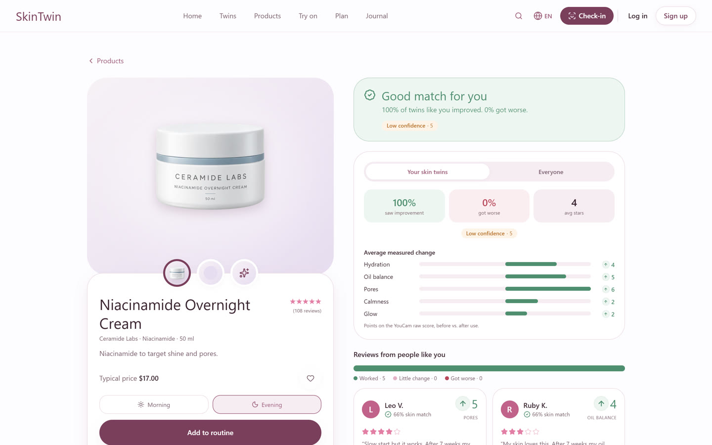 | 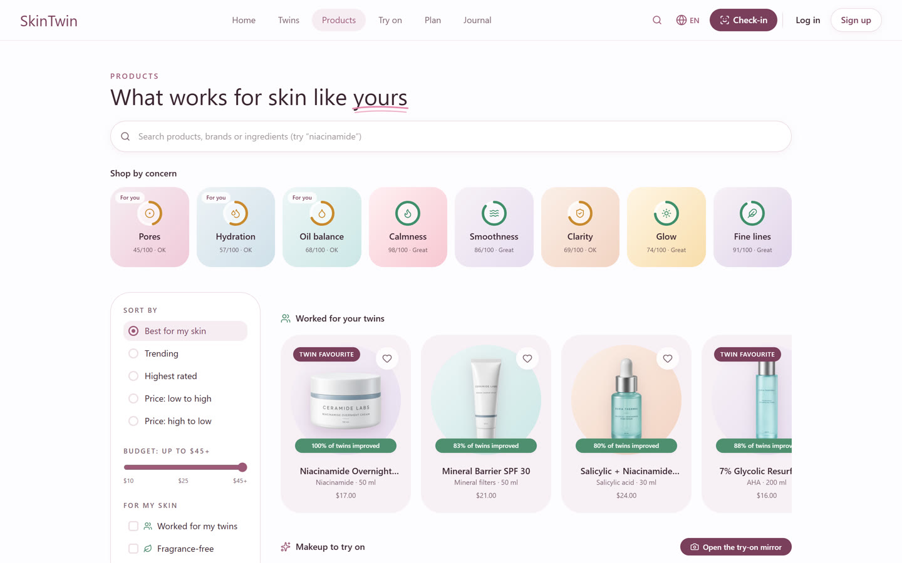 |
| **A verdict for your skin** on every product | **Products** ranked by what worked for your twins |
| 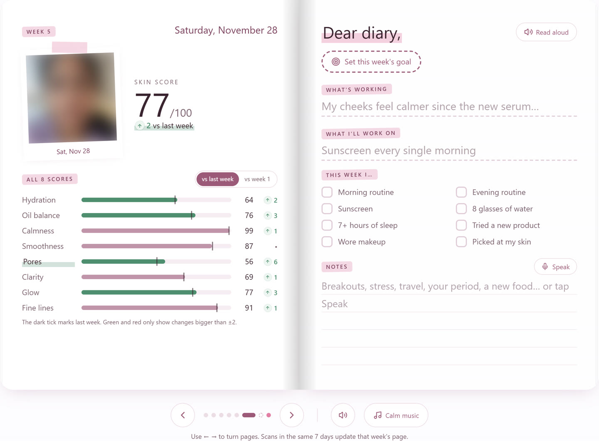 | 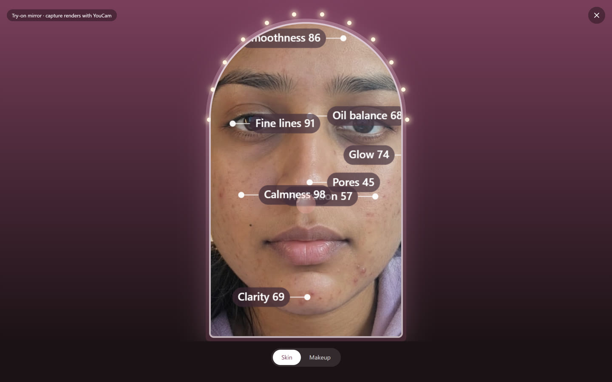 |
| **Skin journal**: one page per weekly check-in | **Live mirror** with YouCam makeup try-on |

<p align="center">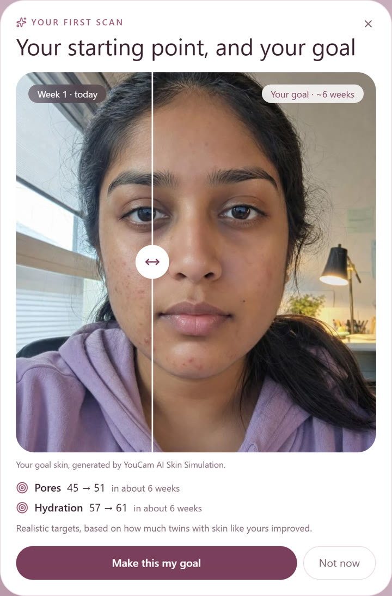<br/>
<b>Your realistic goal skin</b>, made with YouCam AI Skin Simulation</p>

## The journey

1. **What's my skin like?** A 10-second scan gives 8 scores on a face map, kept in *My skin*.
2. **Who has skin like mine?** Your skin twins (80%+ match) with their scan-verified results.
3. **What worked for them, and will it work for me?** Every product gets a verdict for your skin ("Good match",
   "Mixed", "Risky", or "Few twins tried"), a confidence level, and *Where to buy* links.
4. **Is it working for me?** A routine with a weekly planner, weekly check-ins in a journal book, a realistic goal, and a
   keep / pause / swap call per product.

## Features

- **Scan**: camera with face guide, light check and retake; photo upload; a sample face.
- **My skin**: face map, heat map, 8 score rings, progress, goal, live AR mirror.
- **Twins**: twin matcher, visual feed, follow, twin profiles, and "copy their routine" with swaps from products you
  already own.
- **Products**: verdict per product, "Popular but risky for you", concern tiles, filters, Quick pick (swipe).
- **Plan**: today's routine, weekly planner, Mix Lab (preview a combination), "Add what I own" from a cart screenshot or
  link (read on the device).
- **Journal**: a page-turning skin journal, one page per weekly check-in, goals with a celebration when your scans
  confirm them, daily care (hydration, sleep wind-down, a calm breathing minute) and a daily skin tip.
- **Makeup**: shade match from your photo (on the device), what your twins wear, live try-on with YouCam Camera Kit.
- **Languages**: English and Arabic (right-to-left).

## YouCam APIs

| API | Used for |
|---|---|
| **AI Skin Analysis** (SD, 8 concerns: moisture, oiliness, redness, texture, pore, acne, radiance, wrinkle) | Scores, face map, heat map, twin matching, weekly check-ins |
| **AI Skin Simulation** | Your realistic goal skin, and Mix Lab's "6 weeks" preview (oiliness is never sent: in this API a higher value adds shine) |
| **AI Makeup Virtual Try-On** | The mirror's *Capture*: the product's real shade rendered on your snapshot |
| **Camera Kit** (web SDK) | Live try-on on your own face |

All calls are server-side (the key never reaches the browser), cached per photo and settings, capped per day and per
visitor, and opt-in: the public app runs in **Demo** mode by default and only calls YouCam when live mode is enabled.
Any failure falls back to demo results. Live face tracking in the mirror and shade matching run in the browser
(MediaPipe), so they cost no units.

## How twin matching works

Each person is a vector of the 8 YouCam scores (0-100). Similarity is

```
match = max(0, 100 − 2.5 × RMS(user − other))
```

so an 80% match means the scores differ by about 8 points on average. That's stricter than plain Euclidean distance over
the maximum distance, which would rate almost everyone above 80%. A **twin** is 80% or more. Product verdicts use twins'
measured before/after changes; with fewer than 5 twins, the app says so and shows everyone's results instead.

Code: `web/src/lib/twins.ts` (matching and outcomes), `web/src/lib/verdict.ts` (verdicts),
`web/src/lib/mix.ts` (combinations), `web/src/lib/planner.ts` (weekly planner), `web/src/lib/substitute.ts` (swaps).

## Run locally (judges)

```bash
cd web
cp .env.example .env.local   # then fill in the values
npm install
npm run dev
npm test                     # core logic tests
```

Open http://localhost:3000. Supabase (accounts and community reviews) is optional: without it, everything except posting
reviews works. The database tables are in `supabase/schema.sql` and `supabase/add-photos-and-links.sql`.

## Data honesty

- The twin community (1,240 profiles) and its product outcomes are **synthetic demo data**, generated by a documented,
  seeded model in `web/src/lib/cohort.ts`, and labelled as sample data in the app.
- Products are a demo catalogue with fictional brands (Aura Thermal, Ceramide Labs, Botanical Glow, Sunmere, Fernlore), so no
  third-party trademarks appear. Ingredient lists are realistic INCI formulations, several adapted from
  [Open Beauty Facts](https://world.openbeautyfacts.org) (ODbL).
- Results are cosmetic guidance, not medical advice.

## License

**Copyright © 2026 Reem Chalak. All rights reserved.**

This repository, the deployed app, the SkinTwin name, logo, design and product concept are shared **only so the
hackathon's organizers, judges and sponsors can evaluate this submission**. No right to copy, modify, redistribute,
reuse or build on any part of it is granted. See [LICENSE](LICENSE) for the full terms.
